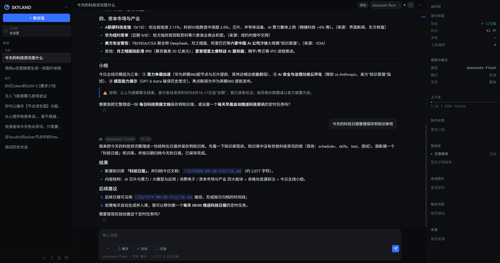
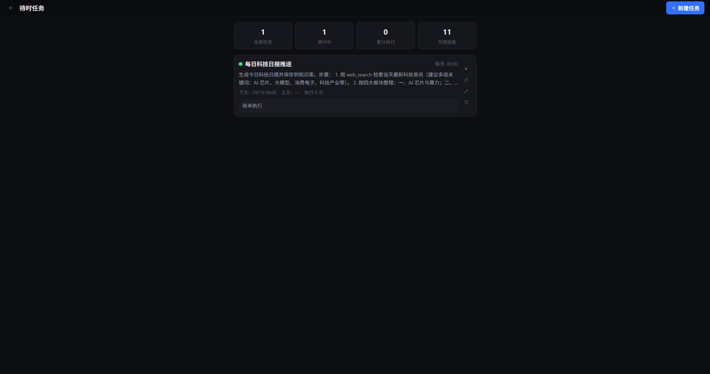
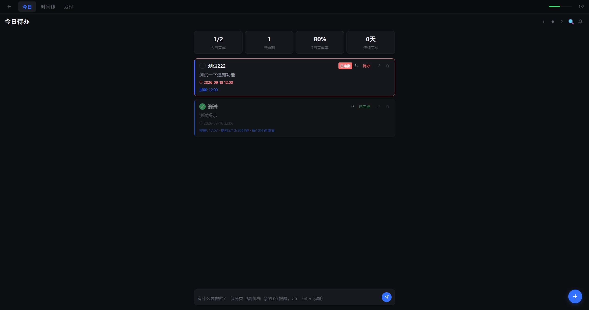
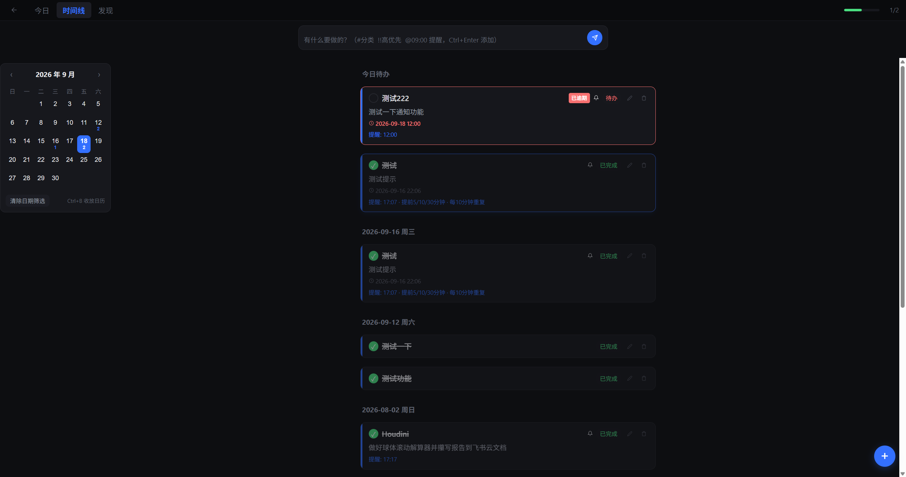
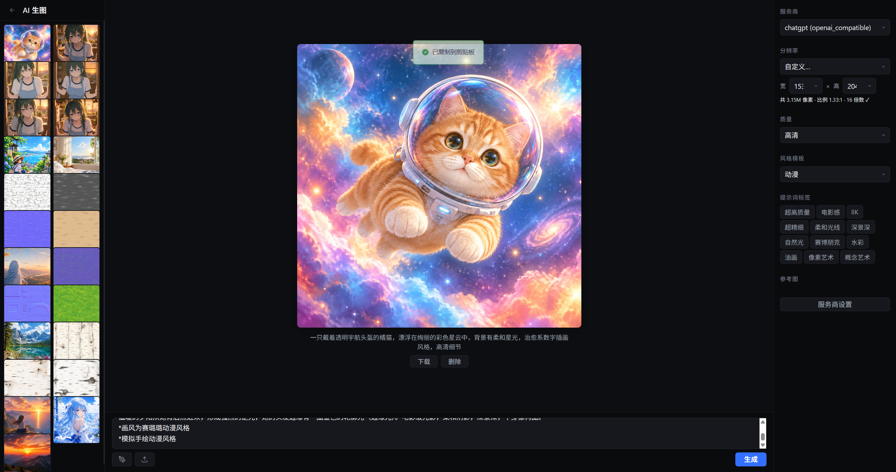
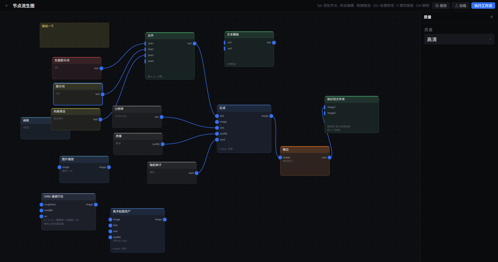
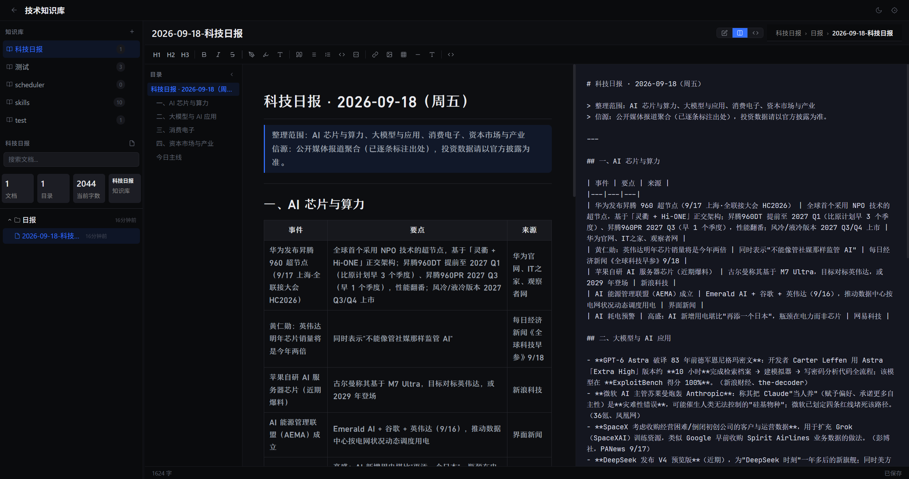
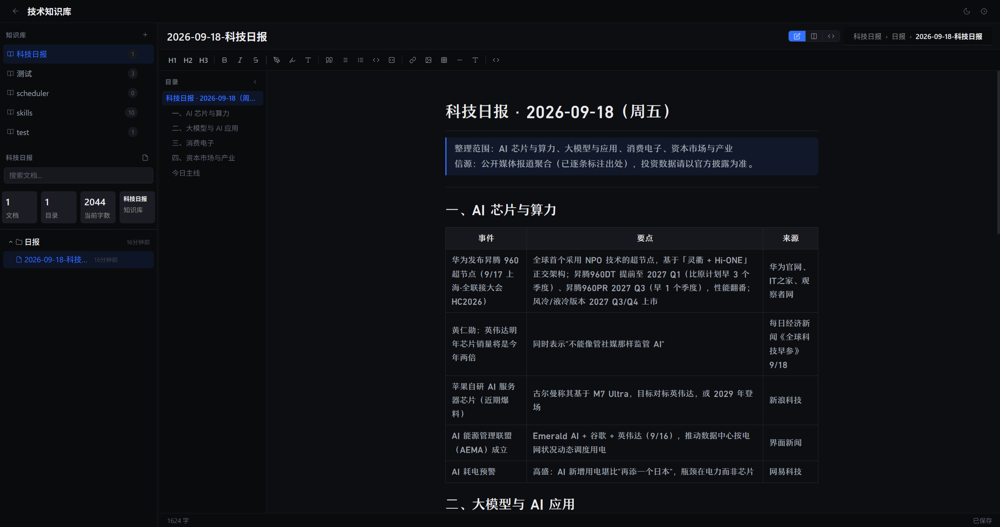

# SKYLAND

**An easier-to-use Agent workstation.**

[简体中文](README.md) | English

SKYLAND brings Agent conversations, scheduled tasks, to-dos with memos integration, image generation, and a Markdown knowledge base into one desktop workspace. Turn conversations into actions, keep useful results, and reuse them in the next task.

[Download for Windows](https://github.com/Stars401/SKYLAND/releases) · [MIT License](LICENSE)

## Get Started

1. Download the Windows x64 installer from [GitHub Releases](https://github.com/Stars401/SKYLAND/releases). The current public release is a preview.
2. Launch SKYLAND and select a data directory when prompted, or use the default.
3. Configure your model provider, endpoint, model, and API key in Settings. Configure an image provider separately for image generation.
4. Start an Agent conversation, capture to-dos, or create a scheduled task.

Service availability, supported parameters, and costs depend on the providers you configure. The interface uses system fonts by default.

## Features in Pictures

These eight screenshots show real project interfaces from development; layout and wording may vary by release. They show a Chinese UI; English documentation does not imply full English UI localization.

### Agent Conversations

Work with an Agent in a workspace, switch configured models and execution modes, and revisit conversation history. Follow progress, tool calls, context usage, plans, attachments, outputs, and sources in the execution panel.

Tools connect conversations to knowledge-base searches, document reading, and to-do management. The Agent can create to-dos and scheduled tasks where the execution mode permits. Available tools and services determine its actual capabilities.



### Scheduled Tasks

Schedule an Agent prompt once, daily, on selected weekdays, or at a recurring interval. Review previous and upcoming runs, execution counts, and results; run tasks manually or edit their schedules.

For example, schedule a daily technology briefing and let the Agent gather and organize information using its configured tools. The SKYLAND service must remain running for scheduled execution.



### Today's To-Dos

Capture tasks with categories, priorities, due dates, and reminders. Quick-entry syntax supports category tags, priority markers, and reminder times. Completion counts, overdue items, recent completion rates, and streak statistics help you review the day.



### Timeline and memos Integration

Browse tasks across dates in a grouped timeline, filter by category, and revisit completed or unfinished items beyond today's list.

Connect a [memos](https://github.com/usememos/memos) instance to pull entries into SKYLAND to-dos. Imports merge into the task list, with optional polling every 15 minutes while the service runs. Synchronization imports from memos into SKYLAND; SKYLAND changes are not written back to memos.



### Image Generation Terminal

Generate images from prompts in a dedicated workspace. Select a configured provider, resolution, quality, and style; use reference images where supported. Browse generation history, inspect results, and download or delete images.

Reference-image editing and generation parameters depend on the provider and model.



### Visual Image Workflows

Connect prompts, text templates, style presets, image inputs, generation, and output nodes into reusable workflows. Save and load workflows to avoid repeating the same setup.

The editor also includes image resizing and ORM texture-channel packing for art asset workflows. Node parameters take effect where the selected backend supports them.



### Markdown Editing

Organize documents in knowledge-base folders and edit Markdown with formatting tools, an outline, and source/preview views. Keep notes, research, and task outputs alongside the Agent workflows that use them.



### Knowledge Base Reading

Read formatted documents with headings, tables, code blocks, and a navigable outline. Folder navigation, document search, and statistics help you find accumulated knowledge. Agent tools can search and read this material during conversations.



## Project Evolution

SKYLAND grew from an early terminal Agent prototype into a desktop workstation. Its iteration records trace streaming conversations and multiple providers, the Markdown knowledge base, image generation and node workflows, richer to-dos and reminders, conversation tools for knowledge and tasks, scheduled Agent execution, and workspace/provider management.

This introduction reflects those implemented capabilities and the current source. Historical plans also contain earlier designs and future ideas; they are not promises of functionality in the public preview.

## Data and Privacy

On Windows, the default data directory is `%APPDATA%/SKYLAND`; you can choose a directory during first launch. Configuration, credentials, conversations, and user content are stored locally. Upgrades may reuse existing local data.

The source distribution and installer do not include the developer's keys, accounts, conversations, or personal configuration. Commercial font files are not distributed. Configure your own credentials and keep real keys and runtime data out of Git commits.

The preview is recommended for personal use on a single machine. Separate machines and operating-system accounts normally keep their own data. Multi-user authorization boundaries within a shared service have not undergone a complete security audit; do not deploy this preview as a public multi-tenant service.

Model requests may send prompts, selected content, and attachments to your configured providers. Choose services accordingly. Local data storage does not mean model inference runs offline.

## Build from Source

The desktop app uses Rust, Tauri 2, and WebView2. The web service uses Axum with an HTML/CSS/JavaScript interface.

For the Windows installer, install stable Rust, Windows C++ build tools, the Protocol Buffers compiler (`protoc`), WebView2, and Tauri CLI 2:

```powershell
cargo install tauri-cli --version "^2"
cd Project/skyland-app
cargo tauri build --bundles nsis
```

To run the web service for development:

```powershell
cd Project
cargo run -p skyland-web
```

## Contributing

Bug reports and focused improvements are welcome through [Issues](https://github.com/Stars401/SKYLAND/issues) and pull requests. Include the app version, reproduction steps, and expected behavior. Remove keys, private endpoints, and personal content from shared logs and screenshots.

## License

Project code uses the [MIT License](LICENSE). Third-party dependencies retain their respective licenses; bundled frontend libraries include marked (MIT) and highlight.js (BSD-3-Clause).
